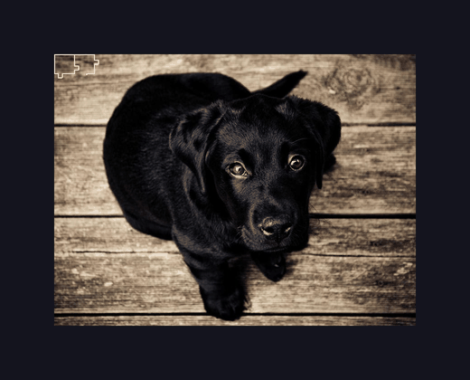

## Puzzle Scramble

A small script that takes an image and cuts it into a bunch of jigsaw pieces. 

### For Recurse Reviewer:

This was inspired by the "Particles, lots of 'em" prompt on the application site. I loosely thought of cutting an image into a bunch of pieces. 

I wrote every line of code here and used an LLM in the same way I'd use Google. I don't have much experience with PyGame so I used Claude's guidance to identify functions for emitting images to a screen and getting the visual running. However, all of the logic and geometry for creating the pieces and adding the "humps" to them was my intuition. For that reason, this is VERY unsophisticated! I purposely didn't do any research into best practices or whether there's a library that handles that for you. 

## ToDo: 
The original idea was to make this a screensaver style animation where the pieces move around and bounce off of each other. Frankly, that ended up being more ambitious than I quite had time for! I think there's a good foundation here but I stopped at getting the puzzle pieces cut out. 

- Make the individual pieces move around the screen in some kind of random drift
- Create a collision effect so that the pieces will bounce off of each other
- Eventually, consider creating a "reassembly" feature where the pieces will eventually reassemble into the original puzzle